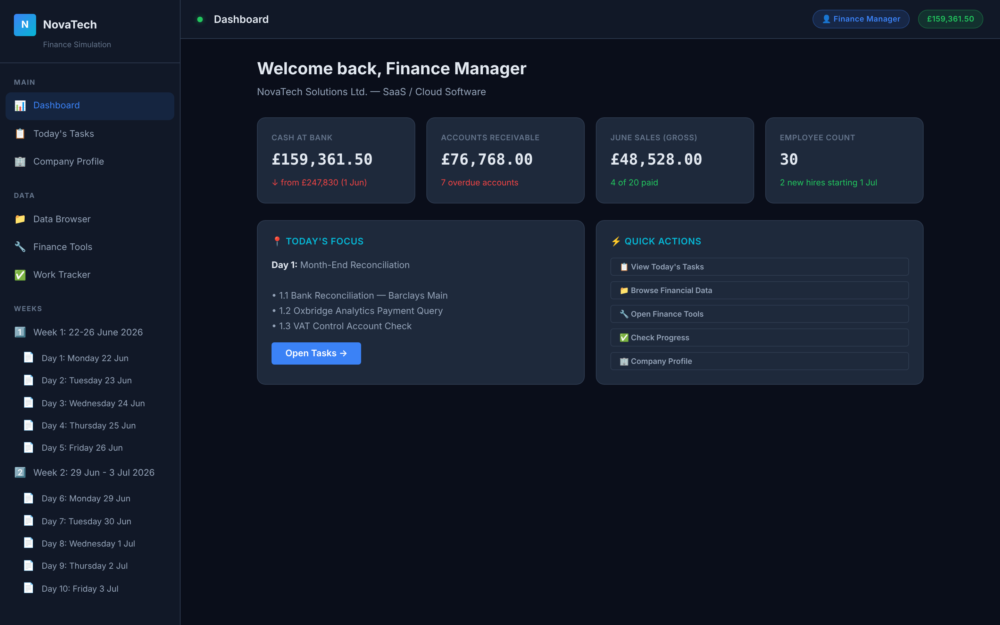
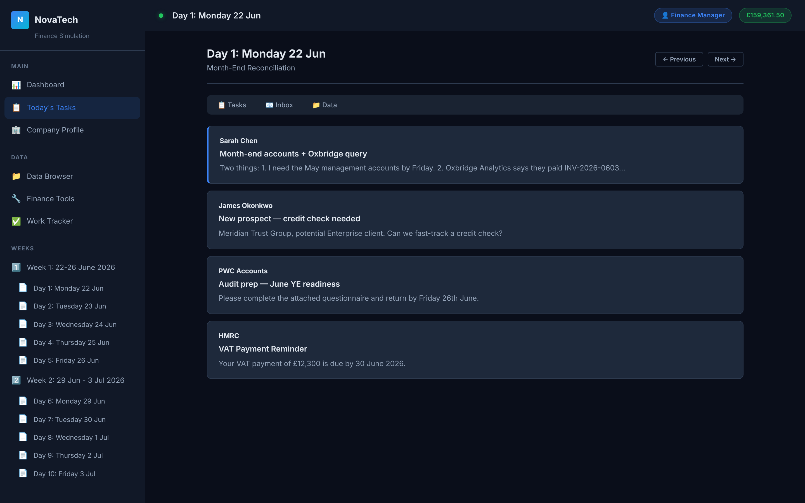
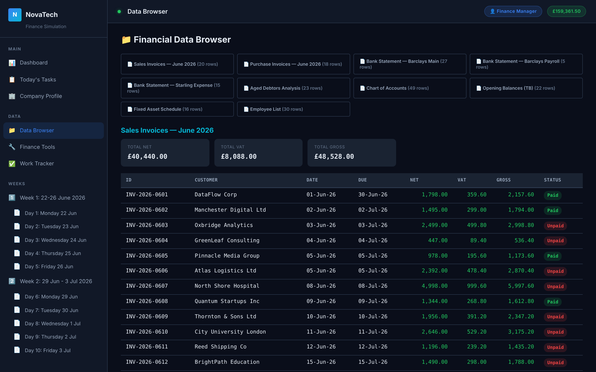
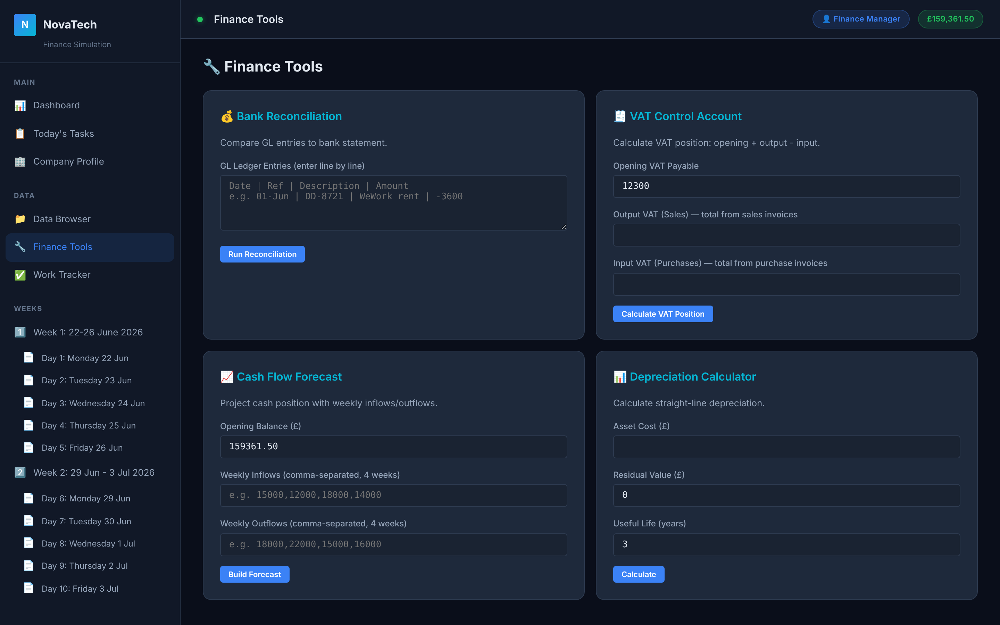
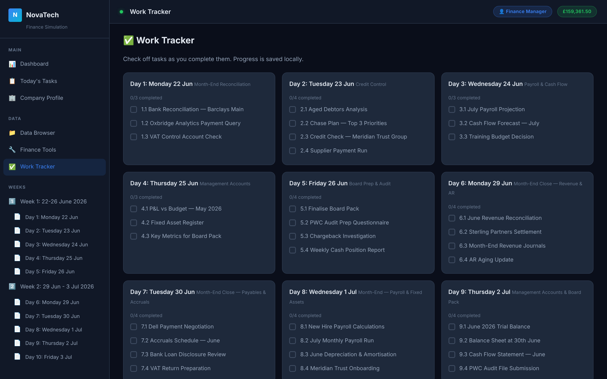
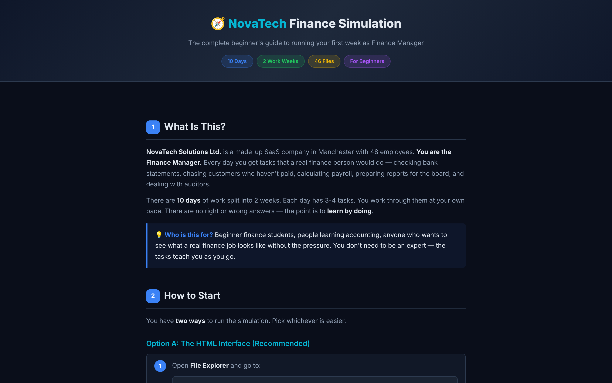

<div align="center">

# NovaTech Finance Simulation

**Two weeks as Finance Manager of a UK SaaS company — realistic data, daily briefs, month-end close and a board pack.**

Reconcile bank accounts, chase debtors, forecast cash, close the month and present to the board, using a browser dashboard, CSV datasets and Markdown task briefs. No installation, no server, no account.

[](ui/index.html)
[](data/)
[](#the-ten-days)
[](https://github.com/mutima89/novatech-finance-sim-/commits)

[Overview](#overview) · [Screenshots](#screenshots) · [Quick start](#quick-start) · [The ten days](#the-ten-days) · [Datasets](#datasets) · [Tools](#built-in-finance-tools)



</div>

---

## Overview

You join **NovaTech Solutions Ltd.**, a fictional Manchester SaaS company with 48 staff and about £1.2M of annual recurring revenue, as its Finance Manager in the last two weeks of June 2026. Each working day brings a brief from the CEO, an inbox and a set of tasks that build on the previous day: mid-month reporting and control in week 1, the full month-end close and board presentation in week 2.

| | |
|---|---|
| **Dashboard** | Cash at bank, debtors, June sales and headcount at a glance |
| **Daily tasks** | 37 tasks across 10 days, each with a brief, deliverables and links to the data |
| **Inbox** | 25 emails from colleagues, customers, auditors and HMRC that feed into the tasks |
| **Data browser** | Every dataset as a sortable table with totals |
| **Finance tools** | Bank reconciliation, VAT control, cash-flow forecast and depreciation calculators |
| **Work tracker** | Tick off tasks as you go; progress is saved in your browser |
| **Company profile** | Banks, people, products and pricing |

## Screenshots

| Inbox | Data browser |
|:---:|:---:|
|  |  |
| **Finance tools** | **Work tracker** |
|  |  |

<details>
<summary>Beginner's guide (<code>ui/how-to.html</code>)</summary>



</details>

## Quick start

Choose whichever suits you:

| Option | How |
|---|---|
| **Browser dashboard** (recommended) | Open `ui/index.html` in any modern browser; it works offline |
| **PowerShell launcher** | `powershell -ExecutionPolicy Bypass -File .\start-simulation.ps1` |
| **Files only** | Read the briefs in `tasks/` and work in Excel from the CSVs in `data/` |

New to finance work? Start with `ui/how-to.html`.

## The ten days

| Day | Date | Role | Focus |
|---|---|---|---|
| 1 | Mon 22 Jun | Accountant | Bank reconciliation, customer payment query, VAT control check |
| 2 | Tue 23 Jun | Credit Controller | Aged debtors, chase plan, credit check, supplier payment run |
| 3 | Wed 24 Jun | FP&A Analyst | Payroll projection, July cash-flow forecast, training budget |
| 4 | Thu 25 Jun | Management Accountant | P&L versus budget, fixed-asset register, board metrics |
| 5 | Fri 26 Jun | Finance Manager | Board pack, audit questionnaire, chargeback investigation |
| 6 | Mon 29 Jun | Accountant | Revenue reconciliation, settlement proposal, month-end journals |
| 7 | Tue 30 Jun | Credit Controller | Supplier negotiation, accruals, VAT return |
| 8 | Wed 1 Jul | FP&A Analyst | New-hire payroll, depreciation, customer onboarding |
| 9 | Thu 2 Jul | Management Accountant | Trial balance, balance sheet, cash-flow statement |
| 10 | Fri 3 Jul | Finance Manager | Board presentation, H2 reforecast, scenario analysis |

The data contains deliberate puzzles — a customer who says they paid, invoices that were settled but are still listed, an early-settlement discount — so read the inbox as carefully as the spreadsheets.

## Datasets

| Dataset | File | Rows |
|---|---|---|
| Sales invoices, June | `data/transactions/sales-invoices-june.csv` | 20 |
| Purchase invoices, June | `data/transactions/purchase-invoices-june.csv` | 18 |
| Barclays main account statement | `data/transactions/bank-statement-barclays-main-june.csv` | 27 |
| Barclays payroll account statement | `data/transactions/bank-statement-barclays-payroll-june.csv` | 5 |
| Starling expense account statement | `data/transactions/bank-statement-starling-june.csv` | 15 |
| Aged debtors | `data/transactions/debtors-aged-analysis.csv` | 23 |
| Chart of accounts | `data/chart-of-accounts.csv` | 50 |
| Opening balances (trial balance, 1 June) | `data/opening-balances-june-2026.csv` | 22 |
| Fixed-asset schedule | `data/assets/fixed-asset-schedule.csv` | 16 |
| Employee list | `data/additional-data/employee-list.csv` | 30 |
| FY2026 budget | `data/budgets/fy2026-budget.csv` | 31 |
| Journal templates and samples | `data/journals/` | — |

The opening trial balance balances (assets £573,880.55 = liabilities £140,950.00 + equity £432,930.55), and every bank statement's running balance recomputes without error.

## Built-in finance tools

| Tool | Input | Output |
|---|---|---|
| Bank reconciliation | General-ledger lines (date, reference, description, amount) | Ledger total compared with the bank statement |
| VAT control account | Opening VAT, output VAT, input VAT | Amount due to or from HMRC |
| Cash-flow forecast | Opening balance, weekly inflows and outflows | Projected weekly balance with shortfall warnings |
| Depreciation | Cost, residual value, useful life | Annual and monthly straight-line charge |

Blank working templates for reconciliations, cash-flow, P&L and the fixed-asset register are in `tools/`; PowerShell equivalents of three calculators are in `scripts/`.

## Project structure

```text
novatech-finance-sim-/
├── ui/                     Browser dashboard (index.html, how-to.html, css/, js/)
├── tasks/                  Daily briefs: days 1–5, plus week2/ for days 6–10
├── data/                   Transactions, ledgers, budget, assets, staff, inboxes
├── processes/              Finance policies and the month-end close checklist
├── tools/                  Blank CSV working templates
├── scripts/                PowerShell calculators
├── output/tracker.md       Progress log template
├── company-profile.md
└── start-simulation.ps1
```

## Notes

- All companies, people, bank details and figures are fictional.
- The tracker stores progress in your browser's local storage; clearing site data resets it.
- No licence has been chosen for this repository yet, so all rights are reserved by the author.
